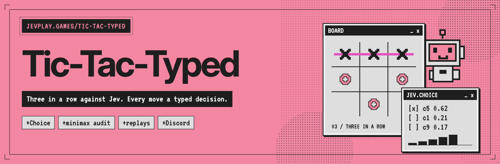
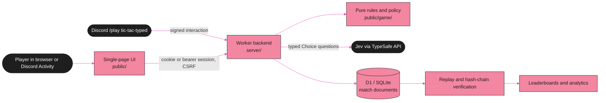

<p align="center"></p>

<div align="center">

# Tic-Tac-Typed

**Three in a row against Jev, where every Jev move is a typed answer to a typed question, and every move is on the record.**


[Quick start](#quick-start) · [How it works](#how-it-works) · [Discord and ranked play](#discord-and-ranked-play) · [Analytics](#analytics-and-integrity) · [Verify](#verify-the-implementation) · [Benchmark](#benchmark-independently-of-the-ui) · [Repository layout](#repository-layout) · [Contributing](#contributing)

</div>

---

Tic-Tac-Typed is the classic three-in-a-row game, played in one page against Jev. Every Jev move answers a typed question about the board, which is where the name comes from. Behind the game are a real TypeSafe/Jev adapter, an authoritative backend, Discord OAuth and community launch grants, verified leaderboards, replay evidence and exhaustive rules-space analytics. It is part of [jevplay.games](https://jevplay.games), and it can also be played inside Discord.

> [!NOTE]
> **What is shipped and what is measured.**
> - Without credentials, the game runs against a clearly labeled perfect-play fallback. Live Jev play needs a TypeSafe API key, and Discord sign-in needs your own Discord application.
> - The tests mock TypeSafe and Discord.
> - The packaged exhaustive reference audit measures the rules space. It is not a live Jev benchmark, and no live strength claim is made here.

**No browser or server runtime packages are required for the native local server.** The local runtime uses Node's built-in HTTP, Fetch, Web Crypto and SQLite APIs. The Cloudflare deployment uses a Worker, Static Assets and D1.

## Quick start

Requires **Node 22.16.0 or newer**. The package was tested on Node 22.16.0; that version emits an experimental warning for its built-in SQLite module.

```powershell
# Windows PowerShell, after extracting the ZIP:
cd jev-tic-tac-typed
Copy-Item .env.example .env
npm start
```

```sh
# macOS / Linux:
cd jev-tic-tac-typed
cp .env.example .env
npm start
```

Open **http://localhost:8787**. There is no `npm install` step for local gameplay.

Without credentials, the game works against a **clearly labeled perfect-play fallback**. This is not Jev, is not a fabricated model response, and never produces official Jev leaderboard results. Browser-only practice is also available when the API cannot be reached after the page assets have loaded; the application does not install a service worker or promise offline loading of uncached assets.

### Enable actual Jev

Set the following in `.env`, then restart the server:

```dotenv
TYPESAFE_API_KEY=your-private-key
PINNED_JEV_MODEL=jev-1.13.0
```

The key remains server-side. The adapter calls `POST https://api.typesafe.ai/v1/systemone` with the documented `model`, `state`, and `questions` shape. The four profiles change inputs and questions, not the rules:

| Profile | Model inputs / selection |
|---|---|
| Easy | Board and every legal action; one move Choice |
| Normal | Immediate win / threat facts; one move Choice |
| Hard | Fork facts and bounded human-reply summaries; one move Choice |
| Jev | Hard inputs plus a win/draw/loss Choice per candidate; maximize the model's predicted utility |

Normal play is selected by Jev, **not silently corrected by minimax**. Exact minimax is used after selection for evaluation and as the visibly labeled fallback. The intended strength ordering is unverified until live benchmarks are run. Model confidence is not an independently calibrated game-winning probability.

## How it works



The server owns every match. It applies the human move, prepares a structured request for Jev and records the answer. It then verifies the whole match by replaying it from the empty board before the result can count. The browser renders state and evidence, and never holds keys.

## Discord and ranked play

See [the deployment guide](docs/DEPLOYMENT.md) for Discord application setup, the callback URL, `/play tic-tac-typed` (the legacy `/play tic-tac-toe` is still accepted for one release), and Cloudflare deployment. Credentials are configuration tasks, not hard-coded placeholders in the game logic.

Authentication uses `identify` only. Guild installation uses `applications.commands`. Signed Discord interactions issue a five-minute, single-use, user-bound launch code that grants fifteen minutes of verified guild/channel context. No persistent Gateway process or runtime bot token is required by this implementation.

Ranked matches require a signed-in account and an actual configured Jev service. Guest matches are never converted retroactively into ranked games. A server-side fallback or recovery audit gap permanently removes that match from official rankings.

## What is implemented

- Responsive single-page game, all four profiles, human X/O selection, keyboard controls, rules/privacy dialogs, and structured decision evidence.
- Immutable rules, legal-action generation, exact reference evaluator, postgame replay controls, request/response inspection, and JSON/CSV exports.
- Authoritative match creation and actions, optimistic revision checks, decision leases, idempotency receipts, crash-safe request preparation, expiry, resumption, and replay verification.
- Discord OAuth state validation, session rotation, CSRF protection, Ed25519 interaction verification, personal launch grants, and scoped leaderboards.
- Account/session analytics, source separation, profile/model/mark cohorts, per-ply quality, move-frequency maps, latency distributions, tactical opportunities, outcome calibration, token/billing coverage, and anonymous operational counters.
- Offline exhaustive audit, complete state/edge corpus, independent bitboard reference tests, seeded baseline benchmarks, resumable live benchmark tooling, and frozen-policy adversarial evaluation.

## Analytics and integrity

Every accepted move records its legal alternatives, exact before/after value, optimal set, minimax regret, immediate-win/block opportunities, fork features, source, and timestamps. A Jev decision additionally retains the exact structured request, allowlisted response, model ID, probabilities, confidence, input hash, retry attempts, latency, and reported token usage.

A per-match SHA-256-linked event sequence connects the manifest, prepared requests, results, accepted actions, completion, and verification. Exports can be independently replayed and checked without contacting Jev or Discord.

**Hash links are not signatures.** Anyone able to rewrite an entire export can recalculate the chain. Retain a trusted head hash or original export for meaningful tamper comparison. The server's private authoritative match records—not user-imported files—establish leaderboard eligibility.

The dashboard uses at most the latest **500 closed matches**, explicitly reports truncation, and separates observation sources. “Export all my matches” follows history pagination without a 500-match cap. Browser-only practice is labeled untrusted and excluded from server account analytics.

Read [the complete analytics dictionary](docs/ANALYTICS.md) for every metric, denominator, limitation, and export format.

Measured release results, including all three exhaustive offline baselines, are in [verified results](docs/VERIFIED-RESULTS.md).

## Verify the implementation

```sh
npm test
npm run check
npm run audit
```

The packaged audit confirms:

| Reference measurement | Count |
|---|---:|
| All raw 3-state cell assignments | 19,683 |
| Reachable boards | 5,478 |
| Nonterminal reachable boards | 4,520 |
| Rotation/reflection classes | 765 |
| Legal state-transition edges | 16,167 |
| Complete legal games, stopping on first terminal result | 255,168 |

These counts describe the rules, **not Jev's measured strength**. `npm test` independently cross-checks the evaluator using a separate bitboard implementation on every reachable board and legal edge.

```sh
# Verify a completed match export, or the all-matches export:
npm run verify-export -- path/to/export.json
```

[Testing and verification details](docs/TESTING.md) identify exactly which paths were exercised, including the browser test transport limitation and the absence of real provider/OAuth credentials during packaging.

## Benchmark independently of the UI

```sh
# Every nonterminal position, offline exact baseline:
node bench/run.js --mode positions --source minimax --limit 4520 --out bench-runs/minimax

# Scripted baselines:
node bench/run.js --mode positions --source tactical --limit 4520 --out bench-runs/tactical
node bench/run.js --mode positions --source random --limit 4520 --seed 20260922 --out bench-runs/random

# Alternating X/O, no external calls:
node bench/run.js --mode games --source minimax --opponent random --limit 200 --out bench-runs/games

# LIVE Jev: explicitly authorized, bounded, paid API calls.
# Set TYPESAFE_API_KEY in the shell, or use Node's --env-file-if-exists=.env option.
node --env-file-if-exists=.env bench/run.js --source jev --mode positions --profile jev --limit 100 --max-calls 100 --confirm-live --out bench-runs/live-pilot

# Same arguments and source revision, plus --resume:
node --env-file-if-exists=.env bench/run.js --source jev --mode positions --profile jev --limit 100 --max-calls 100 --confirm-live --out bench-runs/live-pilot --resume

# Worst-case opponent against a complete, recorded, frozen repeat-0 policy:
node bench/exploitability.js bench-runs/minimax X
```

For a complete live position evaluation, use `--limit 4520` with a deliberately chosen call budget. At most two transport attempts are made per model decision; single-legal-action positions need no API call. `--repeats`, `--seed`, and `--split development|validation|test|all` support replication and symmetry-grouped splits. Never tune on the held-out test partition and then claim independent performance there.

Uncommitted live requests prevent automatic resume: the harness will not silently re-sample potentially completed inference. Preserve the interrupted run and use a new output directory. Offline baselines and fallback results always have distinct source labels.

## Release notes and boundaries

**October 2026 — renamed to Tic-Tac-Typed.** The game moved from Tic-Tac-Toe on JEV Arcade to Tic-Tac-Typed on jevplay.games. Until the 301 cutover, both `tic-tac-typed.jevplay.games` and `tic-tac-toe.jevplay.games` are served, and both `/play tic-tac-typed` and `/play tic-tac-toe` work. New matches record `gameId: "tic-tac-typed"`; older matches keep `tic-tac-toe` and still verify. The Jev request is unchanged, so model input and request hashes are comparable across the rename. The UI moved to the shared pink/ink pixel-window theme. See [the hostname notes](docs/DEPLOYMENT.md#hostnames-tic-tac-typed-and-the-legacy-tic-tac-toe).

No live TypeSafe quality claim, real Discord login, or production Cloudflare deployment was made during packaging. Their actual credentials and target account are required to perform those external smoke tests. Source and contract tests are not a substitute for that final staging check.

The server verifies its game and opponent, but cannot establish that a human avoided an external solver. Do not advertise the leaderboard as cheat-proof or use it for cash-prize competitions. See [security boundaries](docs/SECURITY.md).

## Repository layout

```text
public/                 single-page UI, pure rules, policy, oracle and analysis
server/                 portable Worker-style backend, auth, Jev, reports
local/                  Node HTTP + built-in SQLite / D1-compatible adapter
migrations/             database schema
bench/                  corpus audit, benchmark runner, frozen policy evaluation
scripts/                export verification, source manifest, Discord command setup
tests/                  exhaustive rules, API/security, adapter, analytics, browser
reports/                generated audits, baseline runs, tests and screenshots
docs/                   architecture, analytics, API, deployment and sources
assets/                 README banner, GitHub social preview and their HTML sources (assets/src/)
wrangler.jsonc          Cloudflare deployment configuration
```

Local data lives in `.data/game.sqlite` and is not included in the ZIP. Secrets, databases, dependency directories, and private browser sessions are excluded from the package.

## Contributing

Issues and pull requests are welcome. Before opening a pull request, run `npm test` and `npm run check`, then regenerate `server/build-info.js`, `reports/build-manifest.json` and `SHA256SUMS` with `node scripts/build-manifest.js`.

Keep `public/game/` free of DOM and I/O. Do not change these stored identifiers without a version bump:

- the rules version `ttt/1`
- the Jev request's `state.game: "tic-tac-toe"`
- the match format

Matches recorded before the Tic-Tac-Typed rename carry `gameId: "tic-tac-toe"` and must keep verifying (see [docs/ARCHITECTURE.md](docs/ARCHITECTURE.md#game-identifiers-after-the-rename)). Licensed under the [MIT License](LICENSE).

<p align="center">
<sub>A jevplay.games game · Steward: CompleteTech LLC · MIT licensed<br>
Not an official TypeSafe AI publication; the pink, ink and pixel-window styling is a nod to <a href="https://typesafe.ai">typesafe.ai</a>. Jev, System One and TypeSafe are their respective owners' names.</sub>
</p>
